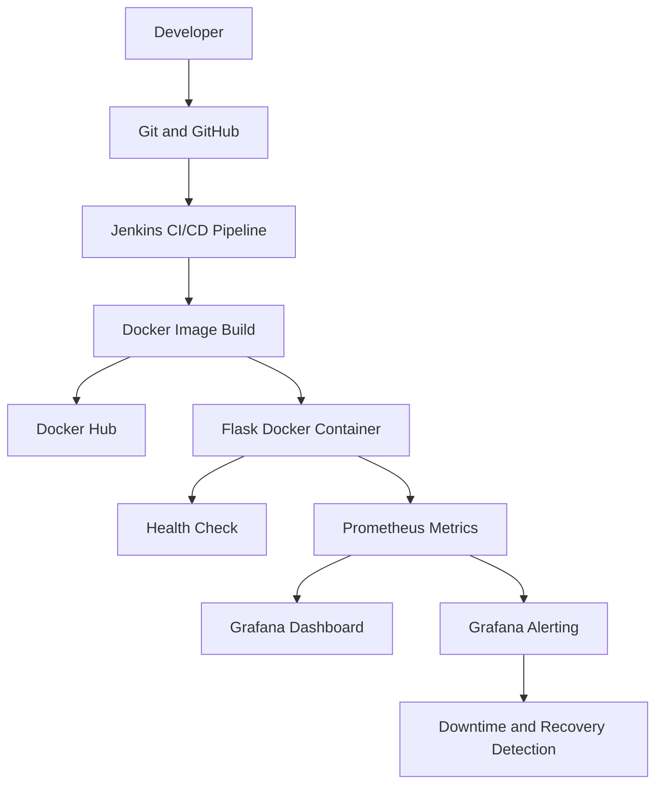
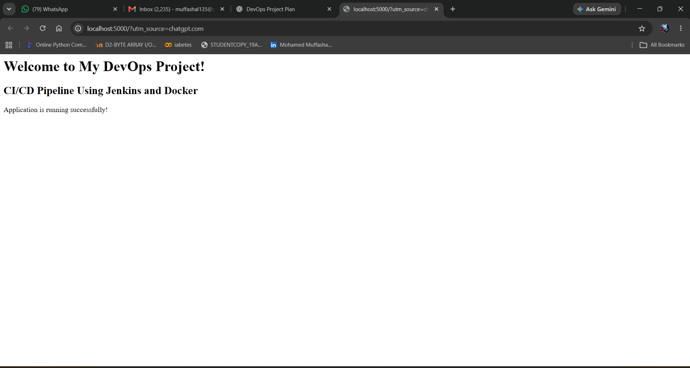
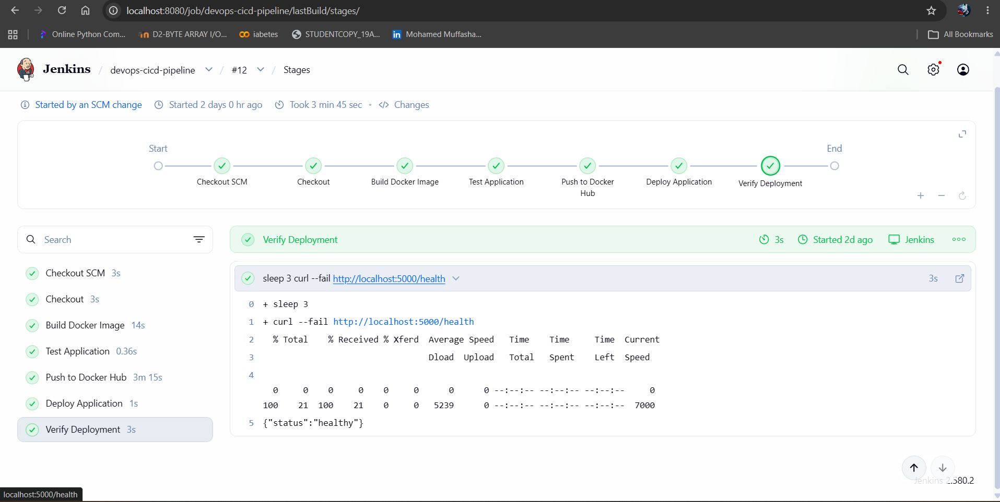
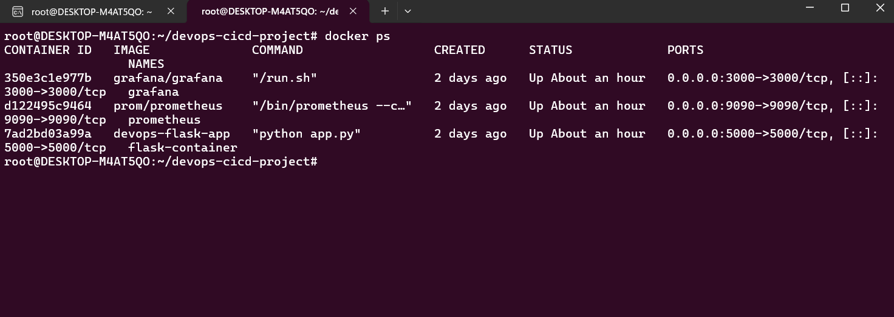
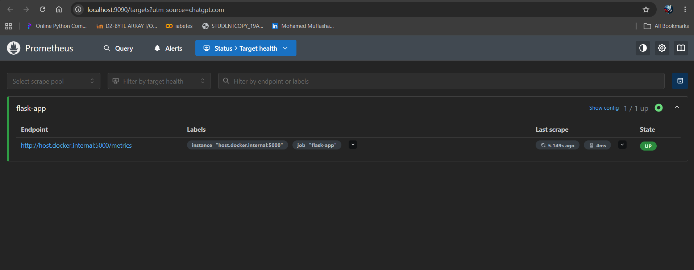
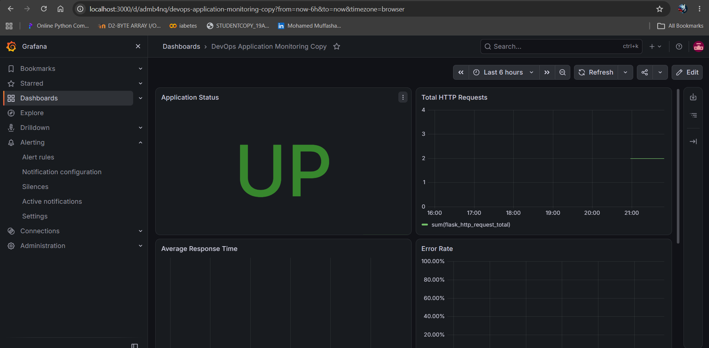
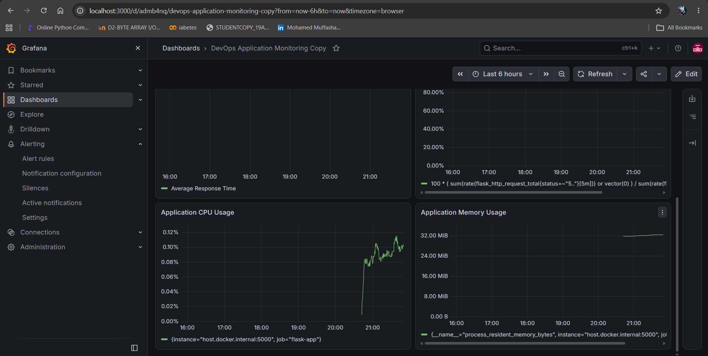
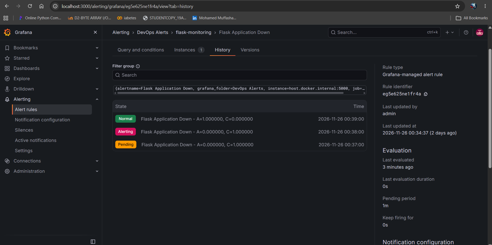

# End-to-End DevOps CI/CD Pipeline with Monitoring

## Project Overview

This project demonstrates an end-to-end DevOps CI/CD pipeline for a Python Flask application using GitHub, Jenkins, Docker, Prometheus, and Grafana.

The project automates application builds, containerized deployment, health verification, performance monitoring, and application failure detection.

## Project Objectives

- Automate application build and deployment.
- Implement Continuous Integration and Continuous Deployment.
- Containerize the Flask application using Docker.
- Monitor application health and performance.
- Detect application failures using Grafana alerts.
- Verify application recovery after downtime.

## Tools and Technologies

| Tool | Purpose |
|------|---------|
| Linux (Ubuntu WSL2) | Development environment |
| Python Flask | Web application |
| Git | Version control |
| GitHub | Source code management |
| Jenkins | CI/CD automation |
| Docker | Containerization |
| Docker Hub | Container image registry |
| Prometheus | Metrics collection |
| Grafana | Monitoring and alerting |
| VS Code | Code editor |

## Project Architecture





## Key Features

- Automated CI/CD pipeline
- Docker image creation
- Containerized application deployment
- Application health verification
- Automatic build triggering
- Real-time application monitoring
- Application downtime detection
- Recovery verification

## Installation and Execution

### Prerequisites

- Linux / Ubuntu WSL2
- Git
- Docker
- Jenkins
- Docker Hub Account
- Internet Connection

### 1. Clone the Repository

```bash
git clone https://github.com/Muffashal/devops-cicd-project.git
cd devops-cicd-project
```

### 2. Build Docker Image

```bash
docker build -t devops-flask-app .
```

### 3. Run Flask Container

```bash
docker run -d --name flask-container -p 5000:5000 devops-flask-app
```

### 4. Verify Application Health

```bash
curl --fail http://localhost:5000/health
```

Expected output:

```json
{"status":"healthy"}
```

### 5. Verify Running Containers

```bash
docker ps
```

### 6. Configure Jenkins CI/CD

- Create a Jenkins Pipeline job.
- Connect the GitHub repository.
- Select Pipeline script from SCM.
- Set the branch to main.
- Set the script path to Jenkinsfile.
- Configure Docker Hub credentials with the ID dockerhub-credentials.
- Ensure Jenkins has permission to execute Docker commands.
- Enable SCM polling for automatic builds.
- Run the pipeline.

### CI/CD Pipeline Stages

| Stage | Description |
|-------|-------------|
| Checkout | Retrieve source code from GitHub |
| Build Docker Image | Build the Flask Docker image |
| Test Application | Verify the Docker image using image inspect |
| Push to Docker Hub | Upload the container image |
| Deploy Application | Deploy the Flask container |
| Verify Deployment | Validate the application health endpoint |

## Monitoring Setup

### 1. Run Prometheus

```bash
docker run -d \
  --name prometheus \
  -p 9090:9090 \
  --add-host=host.docker.internal:host-gateway \
  -v "$(pwd)/promatheus.yml:/etc/prometheus/prometheus.yml:ro" \
  --restart unless-stopped \
  prom/prometheus
```

Open http://localhost:9090/targets and verify that the Flask application target is UP.

### 2. Run Grafana

```bash
docker run -d \
  --name grafana \
  -p 3000:3000 \
  --restart unless-stopped \
  grafana/grafana
```

### 3. Configure Grafana

- Open http://localhost:3000.
- Add Prometheus as a data source.
- Configure the Prometheus connection.
- Create the DevOps Application Monitoring dashboard.
- Configure six monitoring panels.

### 4. Configure Alerting

- Alert Name: Flask Application Down
- Prometheus Query: up{job="flask-app"}
- Threshold: Below 1
- Evaluation Interval: 1 minute
- Pending Period: 1 minute

### 5. Test Application Downtime

```bash
docker stop flask-container
```

Wait until the Grafana alert enters the Alerting state.

### 6. Test Application Recovery

```bash
docker start flask-container
```

Verify that the application status returns to UP and the alert state returns to Normal.

Email and Slack notifications are planned as future enhancements.

## Application Endpoints

- Application: http://localhost:5000
- Health Check: http://localhost:5000/health
- Metrics: http://localhost:5000/metrics
- Prometheus: http://localhost:9090
- Grafana: http://localhost:3000

## Monitoring Dashboard

The Grafana dashboard includes six monitoring panels:

1. Application Status
2. Total HTTP Requests
3. Average Response Time
4. HTTP Error Rate
5. Application CPU Usage
6. Application Memory Usage

## Alerting and Recovery Testing

A Grafana alert rule is configured to detect application downtime.

The alert was tested by stopping and restarting the Flask Docker container.

Alert lifecycle:

- Normal
- Pending
- Alerting
- Normal (Recovered)

Application failure detection and recovery verification were successfully tested.

## Project Results

- Successful Jenkins pipeline execution
- Successful Docker container deployment
- Successful application health verification
- Prometheus metrics collection
- Grafana dashboard visualization
- Successful downtime and recovery testing

## Project Screenshots

### 1. Flask Application


### 2. Jenkins CI/CD Pipeline


### 3. Docker Running Containers


### 4. Prometheus Target Health


### 5. Grafana Monitoring Dashboard




### 6. Grafana Alerting and Recovery



## Future Enhancements

- AWS EC2 cloud deployment
- Email and Slack alert notifications
- Infrastructure automation using Terraform
- Container orchestration using Kubernetes

## Conclusion

This project demonstrates practical DevOps skills in CI/CD automation, containerization, application deployment, monitoring, alerting, and troubleshooting.
